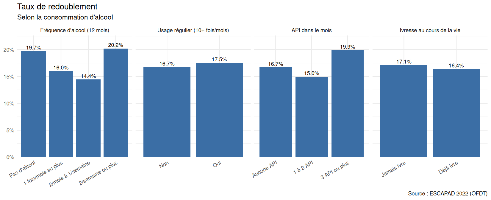
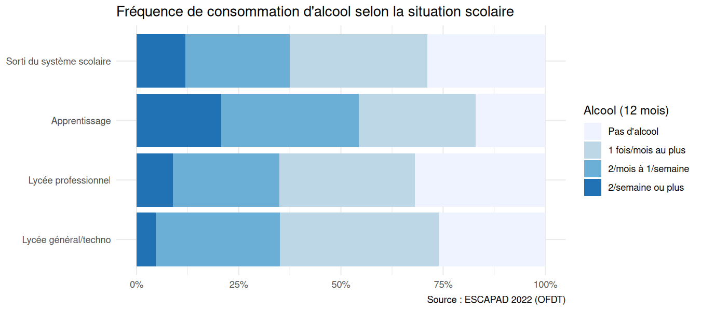
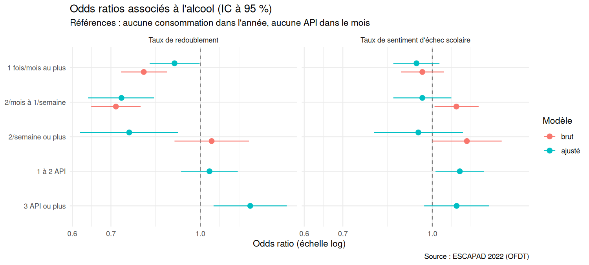
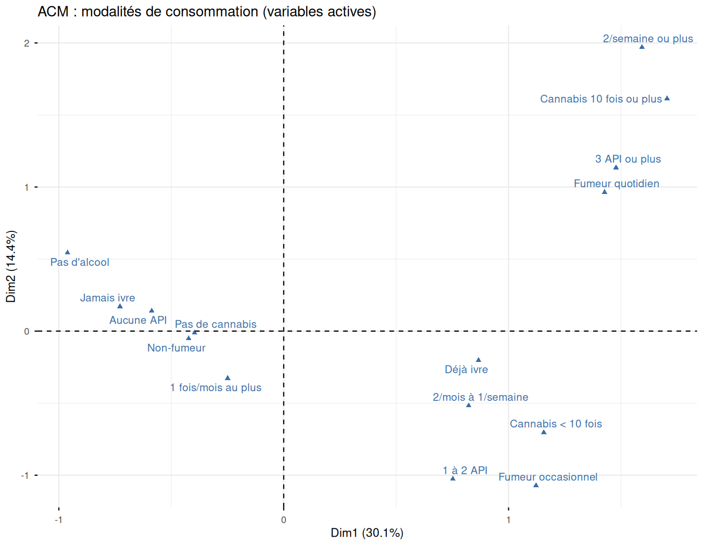
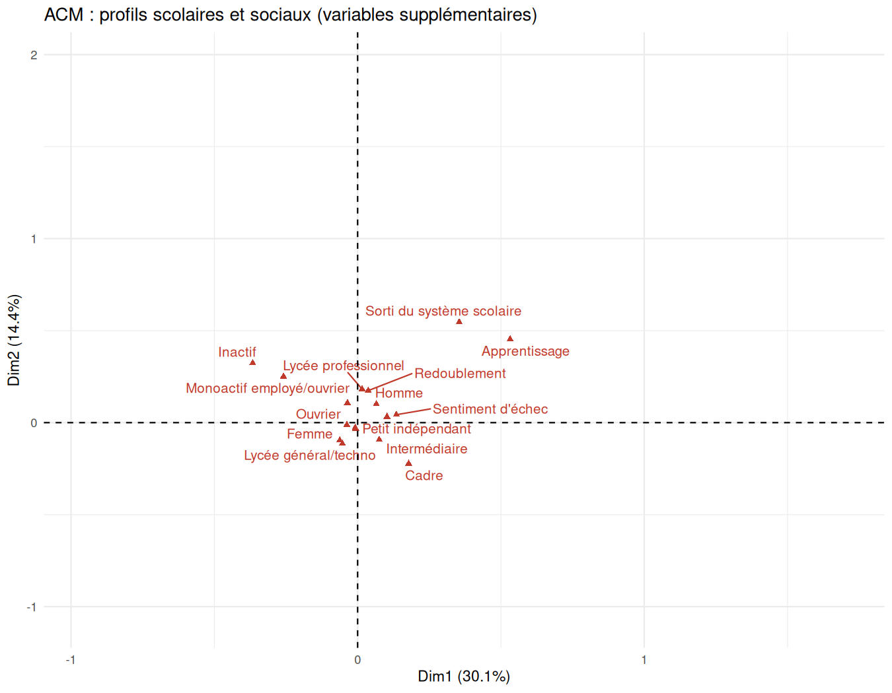

# Consommation d'alcool et réussite scolaire à 17 ans

Projet d'analyse statistique réalisé à l'ENSAI (1re année, septembre 2024 – février 2025), en R.

**Question étudiée :** la consommation d'alcool des adolescents est-elle liée à leur parcours scolaire ? Et cette
liaison tient-elle une fois pris en compte le milieu social, le sexe et les autres consommations ?

## Données

L'analyse repose sur l'enquête **ESCAPAD 2022** de l'OFDT. Ce questionnaire anonyme est rempli par les jeunes
de 17 ans lors de leur Journée défense et citoyenneté. La base compte **22 430 répondants** et plus de
500 variables : consommations de produits, scolarité, santé et situation familiale.

Ces données sont soumises à une convention d'accès : elles ne figurent pas dans ce dépôt. Voir
[`data/README.md`](data/README.md) pour les obtenir et pour le détail des variables utilisées.

## Démarche

### 1. Construction des indicateurs ([`R/01_preparation.R`](R/01_preparation.R))

| Dimension | Indicateurs |
|-----------|-------------|
| **Parcours scolaire** | redoublement ; sentiment d'échec scolaire ; situation scolaire (lycée général, lycée professionnel, apprentissage, sortie du système scolaire) |
| **Alcool** | fréquence sur 12 mois ; usage régulier (10 fois ou plus dans le mois) ; alcoolisations ponctuelles importantes (API, 5 verres ou plus en une occasion) dans le mois ; ivresse au cours de la vie |
| **Contrôles** | sexe ; catégorie socio-professionnelle des parents ; niveau de vie (Family Affluence Scale) ; tabac ; cannabis |

Les seuils (usage régulier, API répétées) reprennent les définitions de l'OFDT, pour rester comparables aux
publications officielles.

### 2. Statistiques descriptives ([`R/02_descriptif.R`](R/02_descriptif.R))

Taux de redoublement et de sentiment d'échec selon chaque indicateur d'alcool. Répartition des fréquences de
consommation selon la filière.

### 3. Tests d'indépendance ([`R/03_tests_independance.R`](R/03_tests_independance.R))

Tests du **khi-deux** entre chaque indicateur d'alcool et chaque indicateur scolaire. Avec plus de
20 000 observations, presque toutes les liaisons sont significatives. L'intensité est donc mesurée par le
**V de Cramér**, qui ne dépend pas de la taille de l'échantillon.

### 4. Régressions logistiques ([`R/04_regression_logistique.R`](R/04_regression_logistique.R))

Pour le redoublement et pour le sentiment d'échec, on estime deux modèles sur le même échantillon :

- un **modèle brut**, avec la seule fréquence d'alcool ;
- un **modèle ajusté**, qui ajoute les API, le sexe, le milieu social, le niveau de vie, le tabac et le cannabis.

La comparaison des **odds ratios** (IC à 95 %) entre les deux modèles montre quelle part de la liaison brute
relève en fait de ces autres facteurs. Les deux modèles sont aussi comparés par test du rapport de vraisemblance
et par l'AIC.

### 5. Analyse des correspondances multiples ([`R/05_acm.R`](R/05_acm.R))

ACM sur les consommations (alcool, API, ivresse, tabac, cannabis), avec FactoMineR. Le parcours scolaire, le
sexe et le milieu social sont projetés en **variables supplémentaires**, pour situer les profils scolaires dans
l'espace des comportements de consommation sans qu'ils influencent les axes.

## Résultats

### En bref

- **Le lien brut entre alcool et redoublement est en U.** Les non-buveurs (19,7 %) et les jeunes qui boivent au
  moins deux fois par semaine (20,2 %) redoublent plus souvent que les buveurs modérés (14,4 %).
- **Ce lien vient surtout du milieu social.** L'abstinence est bien plus fréquente dans les ménages inactifs
  (54 %) que chez les cadres (15 %), et ces mêmes ménages concentrent le redoublement (30 % contre 8 %).
- **Une fois le milieu social, le tabac et le cannabis pris en compte, la fréquence de consommation n'est plus
  associée à davantage de redoublement.** C'est l'**alcoolisation ponctuelle importante répétée** (3 API ou plus
  dans le mois) qui reste associée à un risque plus élevé (OR = 1,22, IC 95 % [1,05 ; 1,41]).
- **Les liaisons sont faibles.** Tous les V de Cramér entre alcool et indicateurs scolaires sont inférieurs à
  0,06 : avec 22 000 répondants, elles sont significatives, mais l'alcool explique peu des parcours scolaires.

### Descriptif



La forme en U se retrouve avec les API : 16,7 % de redoublement sans API, 15,0 % avec 1 à 2 API et 19,9 % au-delà.
Le sentiment d'échec scolaire, lui, augmente doucement avec la consommation : de 20,0 % chez les jeunes jamais
ivres à 23,9 % chez ceux qui l'ont déjà été.

La consommation dépend surtout de la **situation scolaire**. C'est avec cette variable que les liaisons sont les
plus fortes (V de Cramér ≈ 0,10) : 21 % des apprentis boivent au moins deux fois par semaine, contre 5 % des
lycéens en filière générale ou technologique.



### Régressions logistiques



| Redoublement : odds ratio (réf. pas d'alcool) | Brut | Ajusté |
|-----------------------------------------------|-----:|-------:|
| Alcool au plus 1 fois par mois | 0,80 | 0,90 |
| De 2 fois par mois à 1 fois par semaine | 0,71 | 0,73 |
| 2 fois par semaine ou plus | 1,05 (n.s.) | 0,75 |
| 3 API ou plus dans le mois (réf. aucune) | | 1,22 |

- **Le surcroît de redoublement chez les gros buveurs disparaît dans le modèle ajusté**, et passe même sous le
  niveau des non-buveurs. Il tenait à des facteurs associés : le milieu social, et surtout le **tabac quotidien**
  (OR = 2,19), qui est le marqueur de comportement le plus fortement lié au redoublement.
- **Le milieu social domine.** À sexe et consommations égaux, un jeune d'un ménage ouvrier a un risque de
  redoublement presque 3 fois plus élevé (en odds) qu'un enfant de cadres. Ce rapport dépasse 4 pour les ménages
  inactifs.
- **Pour le sentiment d'échec**, la fréquence d'alcool ne joue plus une fois le modèle ajusté. Les facteurs
  associés sont le sexe (OR = 1,93 pour les filles) et l'usage régulier de cannabis (OR = 1,73).
- Le modèle ajusté est nettement meilleur que le modèle brut (test du rapport de vraisemblance, p < 0,001 ; AIC
  qui passe de 18 389 à 17 580 pour le redoublement, sur 20 811 répondants sans valeur manquante).

### Analyse des correspondances multiples

| Modalités de consommation | Profils scolaires et sociaux |
|:-------------------------:|:----------------------------:|
|  |  |

- **Axe 1 (30 % de l'inertie) : l'intensité des consommations.** Il oppose l'abstinence (pas d'alcool, jamais
  ivre, non-fumeur, pas de cannabis) à la consommation.
- **Axe 2 (14 %) : occasionnel ou intensif.** Il sépare l'usage occasionnel (1 à 2 API, fumeur occasionnel) de
  l'usage intensif (alcool 2 fois par semaine ou plus, 3 API ou plus, tabac quotidien, cannabis régulier). Les
  différents produits se consomment donc ensemble : c'est un profil de polyconsommation plus qu'un usage isolé
  d'alcool.
- **Les profils scolaires se projettent près du centre**, signe d'un lien faible avec les consommations. Seuls
  l'apprentissage et la sortie du système scolaire se placent nettement du côté des usages intensifs. Les
  ménages inactifs et monoactifs se placent du côté de l'abstinence.

### Conclusion

À 17 ans, boire de l'alcool, même souvent, n'est pas en soi associé à un parcours scolaire plus difficile une
fois le milieu social pris en compte. Les signaux qui restent sont les **alcoolisations ponctuelles importantes
répétées** et la **polyconsommation** (tabac quotidien, cannabis). Le redoublement reste avant tout marqué par
l'**origine sociale**.

## Utilisation

```bash
git clone https://github.com/AdamLaporte/escapad-alcool-reussite-scolaire.git
cd escapad-alcool-reussite-scolaire
# placer la base dans data/bdd_2022.csv (voir data/README.md)
Rscript analyse.R
```

Les packages manquants (`dplyr`, `ggplot2`, `FactoMineR`, `factoextra`) sont installés au premier lancement.
Le script produit :

| Sortie | Contenu |
|--------|---------|
| `resultats/taux_par_modalite.csv` | Taux de redoublement et d'échec par modalité d'alcool |
| `resultats/tests_chi2.csv` | Khi-deux, p-valeurs et V de Cramér |
| `resultats/odds_ratios.csv` | Odds ratios bruts et ajustés avec IC à 95 % |
| `resultats/acm_valeurs_propres.csv` | Inertie des axes de l'ACM |
| `figures/*.png` | Graphiques descriptifs, forest plot des odds ratios, plans factoriels de l'ACM |

## Limites

- **Pas de causalité.** L'enquête est transversale : on observe des associations, pas des effets. Le
  redoublement a souvent eu lieu avant les consommations mesurées à 17 ans, ce qui rend aussi plausible le sens
  inverse (des difficultés scolaires qui précèdent la consommation).
- **Données déclaratives.** Les consommations sont autodéclarées, avec un risque de sous-déclaration.
- **Mesure partielle de la réussite.** Redoublement, sentiment d'échec et filière n'en saisissent qu'une partie :
  l'enquête ne contient pas les résultats scolaires.
- **Consommations corrélées entre elles.** Alcool, tabac et cannabis vont souvent ensemble (voir l'ACM). Dans le
  modèle ajusté, leurs effets propres sont donc estimés avec prudence : par exemple, l'odds ratio inférieur à 1 du
  cannabis régulier sur le redoublement ne s'interprète que tabac et alcool fixés.
- **Pas de pondération.** La base fournie ne contient pas de poids de redressement. Les résultats portent sur
  l'échantillon.

## Structure

```
escapad-alcool-reussite-scolaire/
├── analyse.R                     # point d'entrée : exécute les étapes dans l'ordre
├── R/
│   ├── 00_packages.R
│   ├── 01_preparation.R          # import et recodage
│   ├── 02_descriptif.R
│   ├── 03_tests_independance.R   # khi-deux et V de Cramér
│   ├── 04_regression_logistique.R
│   └── 05_acm.R
├── archive/projet_16_01.R        # script d'origine du projet (préparation des données)
└── data/README.md                # accès aux données et dictionnaire des variables utilisées
```

## Stack

R · dplyr · ggplot2 · FactoMineR · factoextra · régression logistique (`glm`)

## Auteur

Adam Laporte, ENSAI
